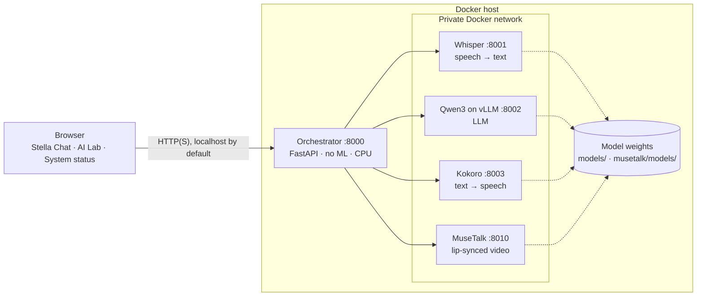
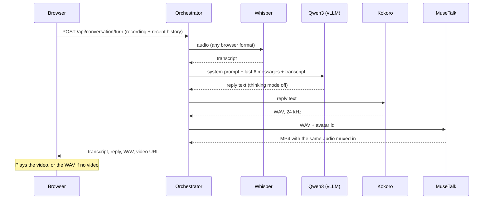

# Stella: Self-Hosted AI Avatar (Proof of Concept)

Stella is a self-hosted talking AI assistant, built as a replacement for HeyGen-style
hosted avatars. You speak to Stella in the browser; she understands you, answers,
speaks the answer in a natural voice and appears as a lip-synced video avatar.
Everything runs on your own hardware, with open models.

| Stage | Model | What it does |
|---|---|---|
| Speech → text | [Whisper](https://github.com/openai/whisper) | Transcribes the user's recording |
| Conversation | [Qwen3](https://huggingface.co/Qwen) (served by [vLLM](https://github.com/vllm-project/vllm) on GPU) | Writes Stella's reply, using the recent conversation |
| Text → speech | [Kokoro-82M](https://github.com/hexgrad/kokoro) | Speaks the reply (24 kHz WAV) |
| Talking face | [MuseTalk 1.5](https://github.com/TMElyralab/MuseTalk) | Lip-syncs Stella's reference video to that speech |

## Project status

| Area | Status |
|---|---|
| Voice pipeline on a CPU laptop (Whisper → Qwen3 → Kokoro) | Working and tested |
| Web UI: Stella Chat, AI Lab, System status | Implemented |
| All-GPU deployment on one NVIDIA L40 server (`compose.gpu.yaml`) | Implemented; **not yet run on the GPU server** |
| MuseTalk avatar | Integrated and tested against a stand-in service; **not yet run on a real GPU** |
| Real-time streaming (LiveKit/WebRTC), interruption, authentication, Stella app integration | Not started (see [Roadmap](#roadmap)) |

## Architecture

Six containers on one Docker host. Only the orchestrator is reachable from outside;
the model services sit on a private Docker network.



### One conversation turn



The MP4 contains the exact audio that drove the lip movement, so voice and lips
cannot drift apart. If MuseTalk is disabled, busy, failing or not running, the turn
still succeeds and Stella answers with her voice only.

### Design principles

- **One model per container.** Each model has its own Python/PyTorch/CUDA stack. They are incompatible with each other (e.g. MuseTalk needs PyTorch 2.0.1 + CUDA 11.8; vLLM needs CUDA 13), so each runs in its own container, and each can be started, stopped and tested on its own.
- **A thin orchestrator.** The orchestrator loads no models. It serves the UI, runs the pipeline, keeps the conversation flowing and reports status.
- **Private model services.** Only the orchestrator publishes a port, bound to `127.0.0.1` by default.
- **Readiness, not just liveness.** Every model service returns `/health` 503 until its model is loaded. The orchestrator checks readiness before each call and returns a clear error instead of hanging.
- **Graceful degradation.** An avatar problem never fails a voice reply.
- **Configuration over code.** Model names, devices, URLs and GPU memory share are environment variables.

## Deployment modes

| Mode | Compose file | Where the models run | Typical use |
|---|---|---|---|
| **CPU laptop** | `compose.yaml` | Whisper, Qwen3 (transformers) and Kokoro on CPU; no avatar | Development and UI work |
| **Mixed GPU host** | `compose.yaml` + `COMPOSE_PROFILES=gpu` | Voice on CPU, MuseTalk on GPU | Avatar testing without a GPU-backed LLM |
| **All-GPU server** | `compose.gpu.yaml` | All four models on one NVIDIA GPU | Target deployment (tested configuration: NVIDIA L40, 46 GB) |

### Model and runtime per service

| Service | CPU mode (`compose.yaml`) | GPU mode (`compose.gpu.yaml`) | Approx. GPU memory |
|---|---|---|---|
| Whisper | `base`, FP32 | `large-v3-turbo`, FP16 · PyTorch 2.6.0 + CUDA 12.6 | 2–3 GB |
| Qwen3 | `Qwen3-0.6B` via transformers | `Qwen3-8B-FP8` via vLLM v0.33.0 (CUDA 13.0), capped at 35 % of the GPU | ~16 GB (fixed budget) |
| Kokoro | Kokoro-82M on CPU | Kokoro-82M on CUDA · PyTorch 2.6.0 + CUDA 12.6 | < 1 GB |
| MuseTalk | only with profile `gpu` | MuseTalk 1.5, FP16 · PyTorch 2.0.1 + CUDA 11.8 | 5–10 GB |
| Orchestrator | Python 3.11, FastAPI | same | none |

GPU figures are estimates until measured on the target server; [DEPLOY_GPU.md](DEPLOY_GPU.md) has the measurement procedure.

## Quick start

### CPU laptop (voice only)

Requires Docker Desktop. From the repository root, in PowerShell:

```powershell
if (-not (Test-Path .env)) { Copy-Item .env.example .env }
docker compose build
docker compose up -d
curl.exe -s http://127.0.0.1:8000/health      # wait for "status":"ok" (about a minute)
```

Open **http://127.0.0.1:8000** in Chrome, Edge or Firefox.

### All-GPU server

```bash
cp .env.gpu.example .env        # set QWEN_API_KEY (required) and MUSETALK_API_KEY
docker compose -f compose.gpu.yaml build      # or load pre-built images
docker compose -f compose.gpu.yaml up -d --no-build qwen   # then whisper, kokoro, musetalk, orchestrator
```

Follow **[DEPLOY_GPU.md](DEPLOY_GPU.md)** for the complete procedure:
- prerequisites and driver/CUDA compatibility;
- building and transferring images;
- downloading model weights;
- the Stella reference video;
- start order and VRAM measurement;
- verification and manual tests;
- optional HTTPS.

## Using Stella

The web UI (http://localhost:8000) has three parts:

| Part | What it does |
|---|---|
| **System status** (top of every page) | Per service: whether its container responds, model loading/readiness or the error, device, GPU memory, load time, recent processing times. Whole-GPU utilization and VRAM; vLLM KV-cache use. Auto-refreshes every 10 s |
| **Stella Chat** | The full conversation: press the microphone (or Space), speak, press again. Shows the transcript, Stella's reply, the avatar video, and per-stage and end-to-end timings |
| **AI Lab** | Test one model at a time, without the others: **Whisper** (record from the microphone or upload a file), **Qwen3** (prompt → reply, time to first token, tokens/s), **Kokoro** (text → playable audio), **MuseTalk** (WAV → video) |

Browsers allow the microphone only on `https://` or `http://localhost`. On a server,
open the UI locally (e.g. over Remote Desktop), through an SSH tunnel
(`ssh -N -L 8000:127.0.0.1:8000 <user>@<server>`), or enable the optional HTTPS mode.

## API

Interactive documentation: http://localhost:8000/docs

| Method | Path | Purpose |
|---|---|---|
| GET | `/health` | Readiness of every service |
| GET | `/api/system/status` | Everything the System status panel shows (health, containers, GPU, timings) |
| POST | `/api/conversation/turn` | One full turn: multipart `file` (any browser audio), `history` (JSON), `voice`, `avatar` |
| POST | `/api/voice/process` | File-based pipeline; WAV saved under `output/api/` |
| POST | `/api/whisper/transcribe` | Whisper only |
| POST | `/api/qwen/generate` | Qwen3 only (includes time to first token on vLLM) |
| POST | `/api/kokoro/synthesize` | Kokoro only |
| POST | `/api/avatar/generate` | MuseTalk only (PCM WAV → MP4) |
| GET | `/api/avatar/status`, `/api/avatar/avatars` | Avatar availability and configured avatars |
| GET | `/api/avatar/videos/{id}.mp4`, `/api/audio/{name}.wav` | Generated media |

Avatar results report a status: `ready`, `disabled`, `off`, `unavailable` or `failed`.

## Configuration

All settings are environment variables in `.env`:
- [`.env.example`](.env.example) for the CPU laptop;
- [`.env.gpu.example`](.env.gpu.example) for the GPU server.

The most important ones:

| Variable | Purpose |
|---|---|
| `QWEN_MODEL`, `WHISPER_MODEL`, `KOKORO_VOICE` | Which models and voice to use |
| `QWEN_SYSTEM_PROMPT` | Stella's personality (empty = built-in default) |
| `CONVERSATION_HISTORY_MESSAGES`, `CONVERSATION_MAX_NEW_TOKENS` | How much history Qwen3 sees; reply length cap |
| `MUSETALK_ENABLED`, `MUSETALK_AVATAR_ID` | Avatar on/off; which `avatars/<id>/` folder to use |
| `VLLM_GPU_MEMORY_UTILIZATION` | vLLM's fixed share of GPU memory (GPU mode) |
| `QWEN_API_KEY`, `MUSETALK_API_KEY` | Shared keys between the orchestrator and the model services (GPU mode) |
| `STELLA_TLS_CERTFILE`, `STELLA_TLS_KEYFILE` | Optional HTTPS for the UI (GPU mode) |

**Stella's face:** put a short, frontal, well-lit reference video at
`avatars/stella/reference.mp4`. Avatar media is never committed to Git; see
[avatars/stella/README.md](avatars/stella/README.md). Use only footage of a person
who has consented to being used as Stella.

## Repository layout

```text
app/
  config.py, schemas.py          settings (environment variables) and request models
  services/                      model logic: whisper, qwen, kokoro, voice pipeline
  servers/                       one FastAPI app per model container (+ /health, /gpu)
  orchestrator/
    main.py                      public API, pipeline, System status
    clients.py                   HTTP clients (Whisper, Qwen3 transformers/vLLM, Kokoro)
    avatar.py                    MuseTalk client and video store
    serve.py                     HTTP/HTTPS launcher (GPU mode)
    static/                      UI: index.html, app.js (Stella Chat), lab.js (AI Lab), status.js
  main.py qwen.py kokoro.py pipeline.py   debugging CLIs
musetalk/                        MuseTalk 1.5 service: CUDA Dockerfile, service code, weight download
avatars/stella/                  avatar reference (not in Git) + instructions
tests/                           contract stubs for MuseTalk and vLLM (test doubles)
requirements/                    pinned dependencies per service
Dockerfile                       orchestrator, whisper, qwen, kokoro, cli images (CPU default, CUDA via build args)
compose.yaml                     CPU laptop / mixed GPU host
compose.gpu.yaml                 all-GPU server
DEPLOY_GPU.md                    GPU server deployment guide
```

## Testing and verification

| Scope | Result |
|---|---|
| **Tested on the CPU laptop** | Browser recordings (webm/opus, ogg/opus) transcribed; 3-turn conversations with history; every individual endpoint; the AI Lab panels; avatar disabled/unreachable/unauthorised paths (the voice reply always arrives); the full avatar success path against a MuseTalk stand-in (MP4 served with range support, H.264 + AAC, deleted on the GPU side) |
| **Test doubles** | [`tests/musetalk_contract_stub.py`](tests/musetalk_contract_stub.py) and [`tests/vllm_contract_stub.py`](tests/vllm_contract_stub.py) implement the service contracts, so the orchestrator can be tested without a GPU |
| **Still needs the GPU server** | All GPU inference; MuseTalk build, avatar preparation and real lip-sync quality; VRAM and latency measurements; the complete pipeline with a real avatar |

Measured on the CPU laptop (warm models): Whisper 3–6 s, Qwen3 3–6 s, Kokoro 2–5 s,
voice turn 8–16 s. MuseTalk is not usable on a CPU (about 10 s per frame), so the avatar
needs an NVIDIA GPU.

## Limitations

- **No streaming yet.** The reply and video arrive when complete; the avatar adds its render time on top of the voice turn.
- **One conversation at a time.** Overlapping turns get HTTP 429; MuseTalk renders one video at a time.
- **No login on the UI.** It is bound to localhost by default; expose it only on a trusted network.
- **MuseTalk's pinned stack** (PyTorch 2.0.1 + CUDA 11.8) does not support RTX 50-series / Blackwell GPUs. It renders the face at 256 × 256, so reference quality matters.
- **Conversation history lives in the browser tab** (sessionStorage), not on the server.

## Roadmap

1. Validate the all-GPU deployment on the target server: VRAM, latency, avatar quality.
2. Real-time conversation over LiveKit/WebRTC: streaming LLM → speech by sentence, streaming avatar frames, voice activity detection and interruption.
3. Authentication, server-side sessions, and concurrent users.
4. Integration with the Stella application.

## Debugging CLIs

```powershell
docker compose --profile cli build cli
docker compose --profile cli run --rm cli python -m app.main --input output/jfk.wav
docker compose --profile cli run --rm cli python -m app.qwen --prompt "Hi Stella"
docker compose --profile cli run --rm cli python -m app.kokoro --text "Hello!" --voice af_heart
docker compose --profile cli run --rm cli python -m app.pipeline --input output/jfk.wav --max-new-tokens 48
```

## Licences

This repository contains integration code only; models are downloaded at deployment time.
Check each upstream licence before commercial use:
- Whisper: MIT.
- Qwen3: Apache-2.0.
- Kokoro-82M: Apache-2.0.
- vLLM: Apache-2.0.
- MuseTalk: see its repository. Its bundled weights (SD-VAE, DWPose, face parsing, Whisper-tiny) have their own licences.
